# Manuel utilisateur — Circuit achats Bank Assafa

Ce guide suit un achat de bout en bout, écran par écran : **demande d’achat**, **demande de prix**, **bon de commande**, **réception**, **facture fournisseur** et **paiement**.

Chaque document métier (sauf la réception) passe par un **circuit de signatures**. Tant que le circuit n’est pas terminé, l’étape suivante reste bloquée : on ne confirme pas la demande, on ne confirme pas la commande, on ne comptabilise pas la facture, on ne solde pas le paiement.

Les captures viennent de l’application **Achats**, société **Bank Assafa**.

---

## 1. Les rôles

| Rôle | Ce qu’il fait |
| --- | --- |
| **Ordonnateur** | Crée la demande d’achat et la signe en premier |
| **Supérieur hiérarchique** | Deuxième signature de la demande. Il est repris de la fiche employé du demandeur (champ **Approbateur**) |
| **Acheteur** | Transforme une demande approuvée en demande de prix |
| **Responsable Achats** | Dernière signature de la demande, première du bon de commande, et signature de la facture |
| **Co-ordonnateur** | Deuxième signature du bon de commande et de la facture, pour son unité opérationnelle |
| **Directeur du Pôle** | Troisième signature du bon de commande entre 40 000 et 700 000 DH TTC |
| **Président** | Troisième signature du bon de commande au-dessus de 700 000 DH TTC |
| **Chargé de facturation** | Première signature de la facture fournisseur |
| **Direction financière** (groupe Chargé règlement) | Dernière signature de la facture |
| **Responsable de règlement** | Signature unique du paiement |

L’unité opérationnelle n’est pas saisie à la main. Elle vient du département du demandeur, et sert au co-ordonnateur pour voir les documents de son périmètre.

---

## 2. Demande d’achat

**Menu :** Achats → Commandes → Demandes d’achat.

### 2.1 Ouvrir la liste

La liste affiche la référence, le demandeur et l’état (**Brouillon**, **In progress**, **Terminé**).

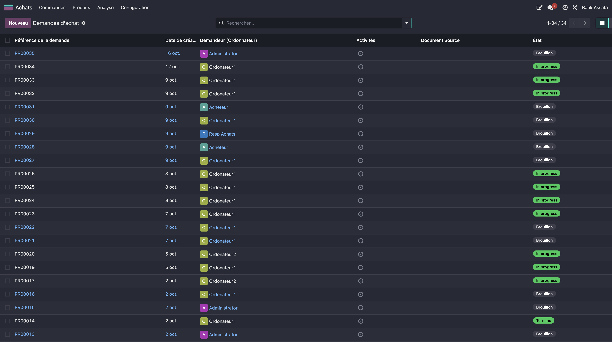

### 2.2 Créer la demande

Cliquez sur **Nouveau**.

Le formulaire s’ouvre en **Brouillon**. Le **Demandeur (Ordonnateur)** est l’utilisateur connecté. L’**Approbateur (supérieur hiérarchique)** se remplit tout seul dès l’enregistrement, à partir de la fiche employé. S’il reste vide, la demande de validation sera refusée : il faut d’abord lier un supérieur, et un utilisateur à ce supérieur, sur la fiche employé.

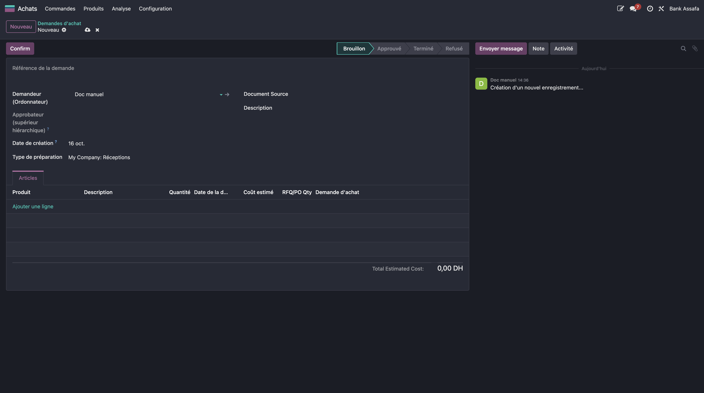

### 2.3 Choisir l’article

1. Dans l’onglet **Articles**, cliquez sur **Ajouter une ligne**.
2. Dans la colonne **Produit**, tapez le nom ou la référence.
3. Choisissez l’article dans la liste (exemple : **Architecte**, référence **AGE001**). Ne cliquez pas sur **Créer** : l’article doit déjà exister dans le référentiel.

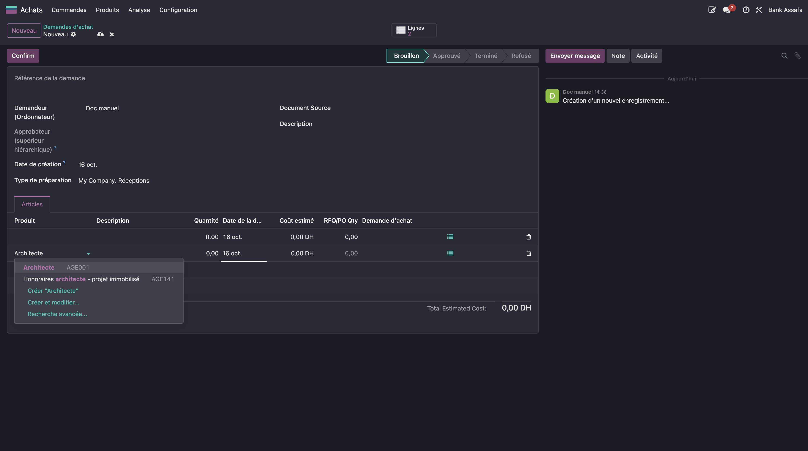

4. La ligne reprend la description de l’article. Saisissez la **quantité**. La **date de la demande** est proposée. Le **coût estimé** peut rester à zéro : le prix réel sera porté sur le bon de commande.
5. Renseignez la **Description** de la demande (objet de l’achat).

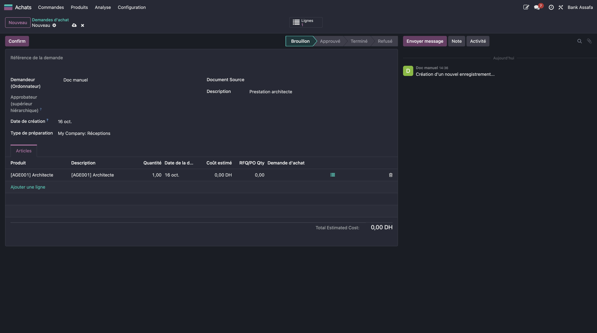

6. Enregistrez (icône d’enregistrement, ou quittez le champ : l’enregistrement est automatique). La référence est attribuée, par exemple **PR00036**. L’approbateur apparaît.

### 2.4 Soumettre pour validation

Sur la demande enregistrée, cliquez sur **Demander validation**.

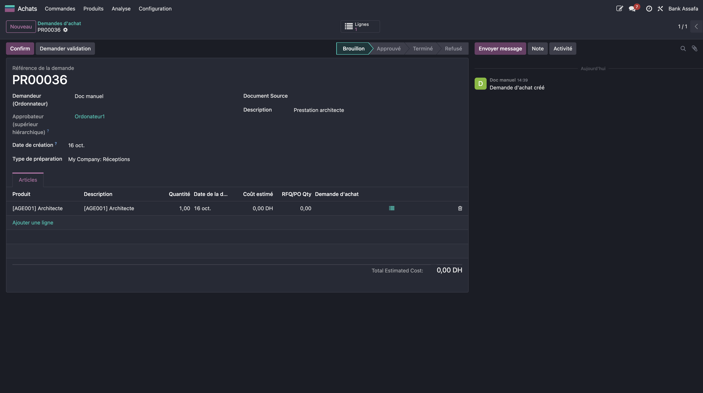

Le bandeau passe au jaune : la première signature est attendue. Le demandeur clique sur **Valider** (ou **Rejeter**).

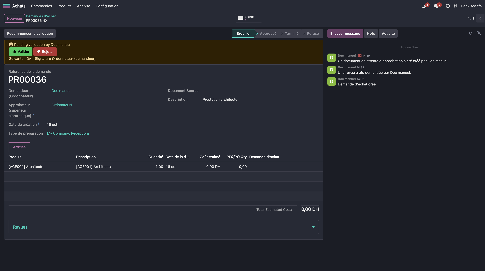

Un commentaire peut être demandé. Saisissez-le, puis cliquez sur **Commentaire**. **Annuler** ferme la fenêtre sans signer.

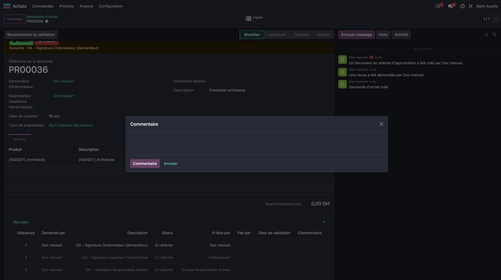

### 2.5 Le circuit, signature après signature

Ouvrez le bloc **Revues** en bas du formulaire. Les trois signatures sont créées dès la demande. Une seule est active à la fois : la suivante passe **En attente** seulement quand la précédente est **Approuvé**.

| Ordre | Signature | Qui signe |
| --- | --- | --- |
| 1 | DA — Signature Ordonnateur (demandeur) | L’utilisateur du champ **Demandeur** |
| 2 | DA — Signature supérieur hiérarchique | L’utilisateur du champ **Approbateur** |
| 3 | DA — Validation Responsable Achats | Le groupe Responsable Achats |

Juste après **Demander validation**, les trois lignes sont **En attente**, et la première est à faire par le demandeur.

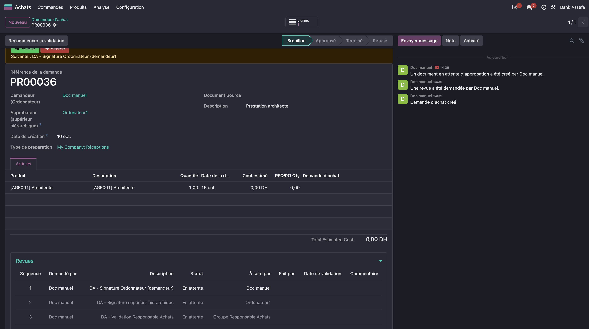

Après la signature du demandeur, le bandeau indique la suite : **DA — Signature supérieur hiérarchique**. Le bouton **Valider** disparaît pour les autres utilisateurs. Le supérieur ouvre la même demande, lit le bandeau, et clique sur **Valider**. Le responsable achats fait de même en dernier.

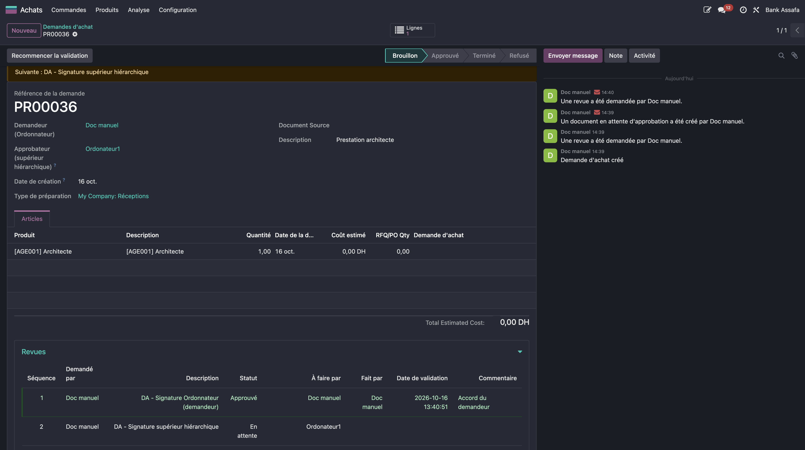

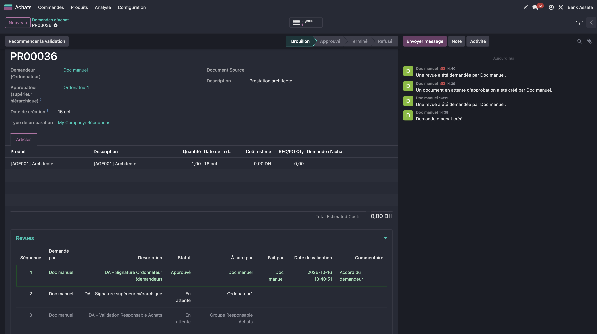

Le demandeur voit passer sa demande dans la messagerie à droite (**Une revue a été demandée**, puis **Une revue a été acceptée**).

Quand les trois lignes sont **Approuvé**, le demandeur (ou un ordonnateur / responsable achats) clique sur **Confirm**. L’état passe de **Brouillon** à **Approuvé**.

Tant que la demande n’est pas approuvée, l’acheteur ne peut pas en faire une demande de prix.

**Recommencer la validation** efface le circuit en cours (les anciennes signatures restent dans l’historique, annulées) et il faut redemander la validation. Seuls les profils autorisés voient ce bouton.

---

## 3. L’acheteur : de la demande approuvée à la demande de prix

**Menu :** Achats → Commandes → Demandes d’achat, puis ouvrez une demande **Approuvée**.

Le bouton **Créer une demande de prix** est visible pour l’**acheteur** (et le responsable achats) uniquement sur une demande **Approuvée** ou **In progress**.

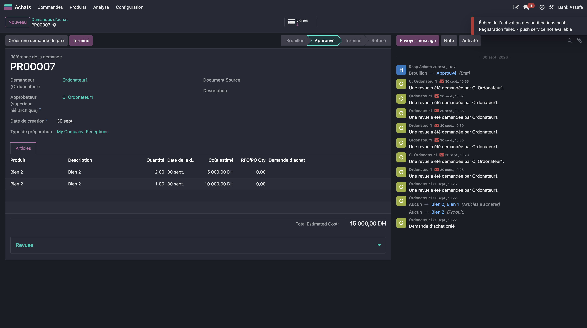

Cliquez sur **Créer une demande de prix**. L’assistant s’ouvre :

1. **Supplier** : choisissez le fournisseur (ici Fournisseur1).
2. Vérifiez les lignes : article, description, quantité à acheter.
3. Laissez décochée **Demande de prix existante** si vous créez une nouvelle commande. Cochez-la seulement pour ajouter ces lignes à une demande de prix déjà ouverte.
4. Cliquez sur **Créer une demande de prix**. **Annuler** ferme l’assistant sans rien créer.

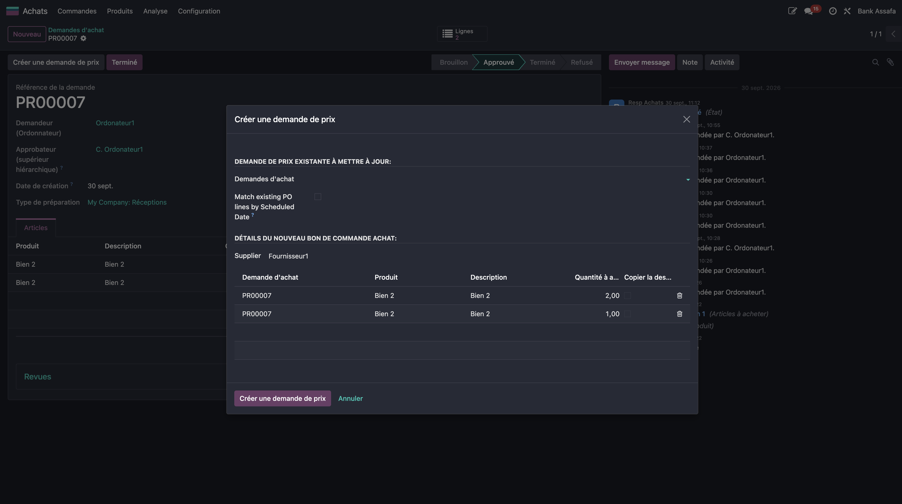

La demande de prix est créée en brouillon, statut **Demande de prix**. Elle porte le fournisseur, les articles, les quantités et les taxes du référentiel (TVA, et les mentions de RAS affichées à titre d’information : elles ne modifient pas le total de la commande).

Exemple **P00046**, fournisseur 7EME AVENUE HOTELS, total **2 400,00 DH**.

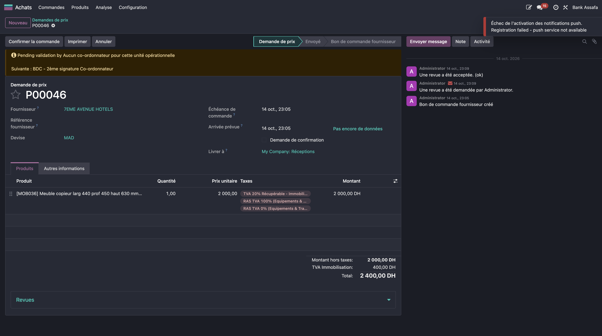

Le bouton **Envoyer une demande de prix** (e-mail au fournisseur) n’apparaît que pour les utilisateurs du groupe prévu à cet effet.

---

## 4. Validation du bon de commande

Le circuit démarre sur la demande de prix. **Confirmer la commande** ne devient possible qu’une fois toutes les signatures obtenues.

| Ordre | Signature | Quand |
| --- | --- | --- |
| 1 | BDC — 1ère signature Responsable Achats | Toujours |
| 2 | BDC — 2ème signature Co-ordonnateur | Toujours, le co-ordonnateur de l’unité opérationnelle |
| 3 | BDC — 3ème signature Directeur du Pôle (40–700 KDH) | Total TTC entre 40 000 DH et 700 000 DH |
| 3 | BDC — 3ème signature Président | Total TTC supérieur à 700 000 DH |

Jusqu’à **40 000 DH TTC**, il n’y a pas de troisième signature.

Sur **P00046** (2 400 DH), deux signatures seulement. La première est déjà **Approuvé**. La deuxième reste **En attente** : le bandeau nomme le signataire suivant. Ici, aucun co-ordonnateur n’est rattaché à l’unité de cette commande, donc la ligne indique **Aucun co-ordonnateur pour cette unité opérationnelle**. Dès qu’un co-ordonnateur est défini pour cette unité, c’est lui qui voit le bouton **Valider**.

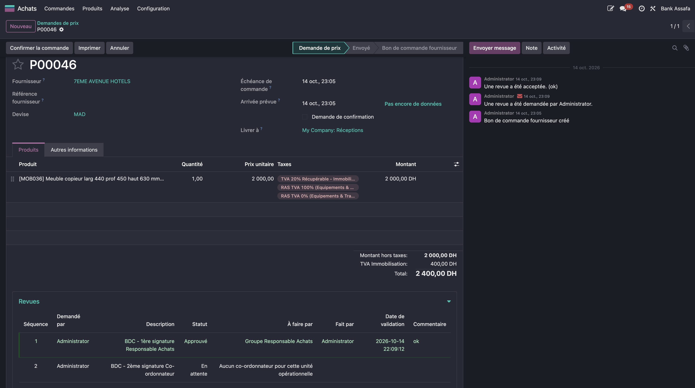

Sur **P00043** (96 000 DH TTC), la troisième ligne apparaît : **Directeur du Pôle**. Elle reste en attente tant que le co-ordonnateur n’a pas signé.

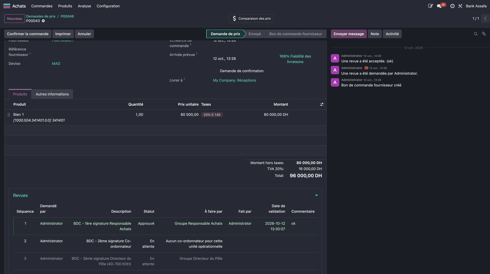

Chaque signataire ouvre le bon, lit le bandeau, clique sur **Valider** ou **Rejeter**, avec un commentaire si la fenêtre le demande.

Quand le circuit est terminé, cliquez sur **Confirmer la commande**. Le statut passe à **Bon de commande fournisseur**.

---

## 5. Réceptionner la marchandise

Il n’y a pas de circuit de signatures sur la réception. On valide les quantités reçues.

1. Ouvrez le **bon de commande** confirmé.
2. Cliquez sur le smart button **Réception** (le chiffre indique le nombre de réceptions).

Sur **P00042**, le bouton affiche **2 Réception**. Une ligne est déjà reçue (colonne **Reçu** = 1,00), l’autre est encore à 0,00. Le smart button **FNP** ouvre la provision de facture non parvenue générée par les réceptions déjà validées.

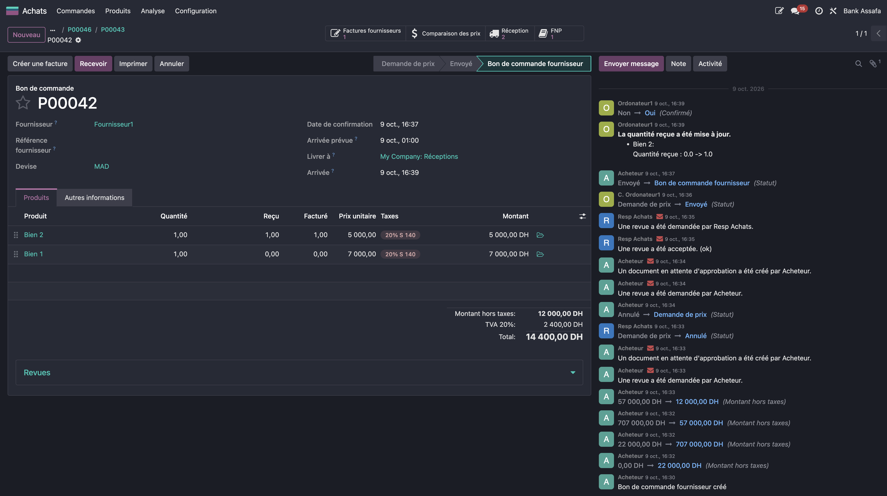

3. La liste des transferts s’ouvre. Ouvrez la réception au statut **Prêt** (exemple **WH/IN/00049**). Une réception **Terminé** est déjà validée.

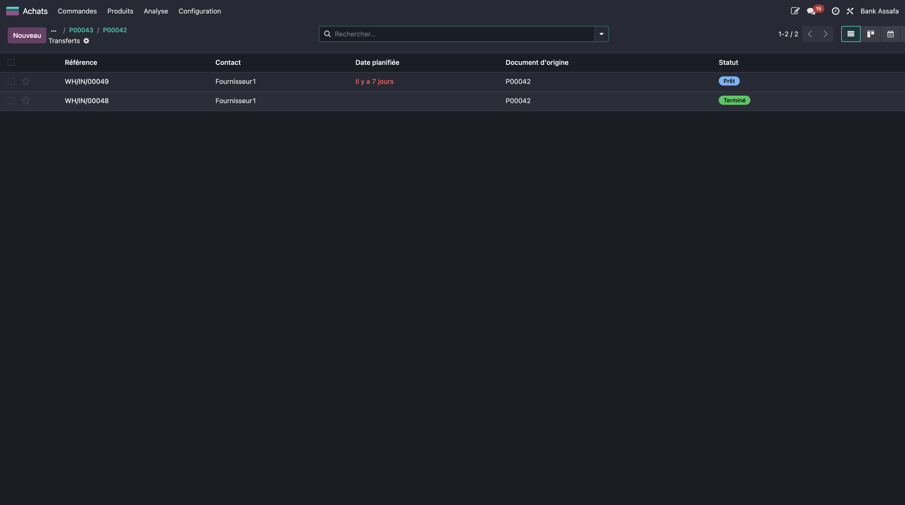

4. Contrôlez l’article, la quantité demandée et la quantité faite. En cas de livraison partielle, baissez la quantité faite : le reste restera à recevoir.
5. Cliquez sur **Valider**.

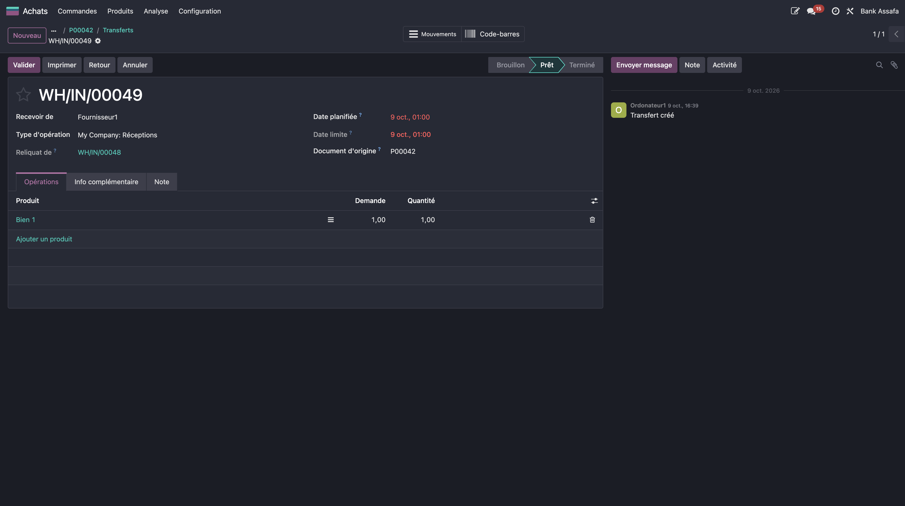

La validation crée la provision **FNP** (charge ou immobilisation constatée avant la facture, sur le compte FNP du fournisseur). Cette provision est extournée quand la facture fournisseur est comptabilisée. Une même réception ne génère qu’une provision.

Le bouton **Recevoir** sur le bon de commande ouvre la même réception.

---

## 6. Facture fournisseur

**Menu :** Comptabilité → Fournisseurs → Factures, ou le bouton **Créer une facture** sur le bon de commande confirmé.

### 6.1 Créer la facture

Depuis le bon de commande, **Créer une facture** reprend le fournisseur, les articles, les quantités reçues, les prix et la TVA. Le fournisseur d’une facture issue d’un bon de commande ne se change plus.

On peut aussi créer la facture directement (**Nouveau** dans Factures fournisseurs). L’unité opérationnelle est alors celle du département de la personne qui crée la facture.

La facture brouillon porte le bouton **Demander validation**. Les taxes de la ligne sont la TVA, plus la RAS seulement si le moteur fiscal la propose (nature de la prestation, statut du fournisseur, seuils de 5 000 DH par facture et 50 000 DH par mois). Le total reste **HT + TVA**. La RAS n’est pas déduite ici : elle le sera au paiement.

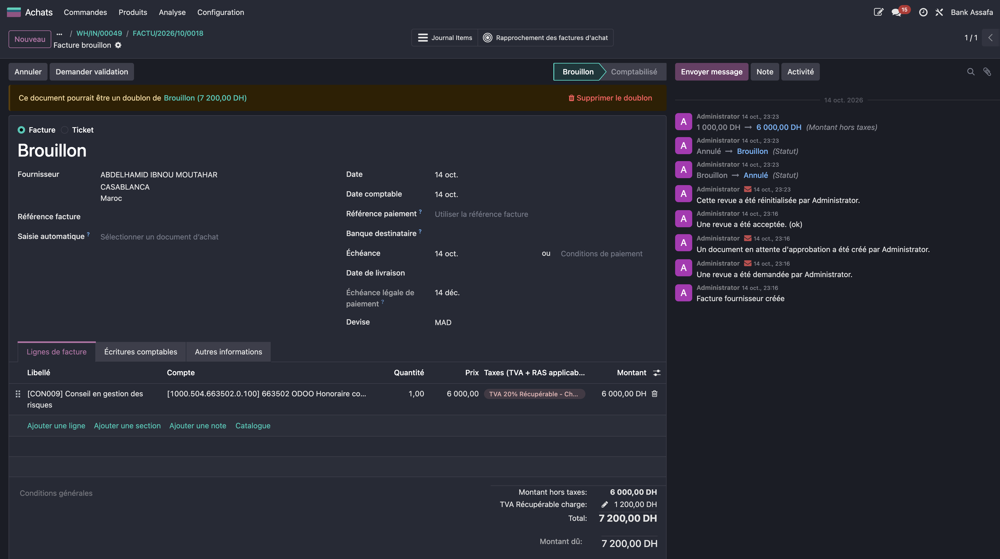

### 6.2 Faire signer la facture

Cliquez sur **Demander validation**. Les signataires se suivent. Chacun ouvre la facture, clique sur **Valider** ou **Rejeter**, et commente si la fenêtre s’ouvre.

| Ordre | Signature | Qui |
| --- | --- | --- |
| 1 | Validation Chargé facturation | Groupe Chargé de facturation |
| 2 | Validation Co-ordonnateur | Co-ordonnateur de l’unité |
| 3 | Validation Responsable achats | Groupe Responsable Achats |
| 4 | Validation Direction financière | Groupe Chargé règlement |

**Comptabiliser** n’est possible qu’après la dernière signature. Sans cela, la comptabilisation est bloquée.

La facture **FACTU/2026/10/0018** est **Comptabilisée**. Le bouton **Payer** est disponible. Les quatre revues sont **Approuvé**.

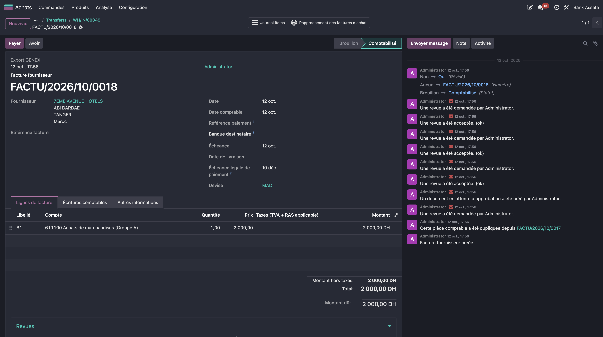

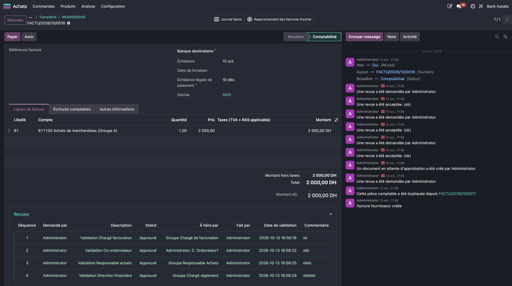

Les comptes de RAS (361904, 361905, etc.) ne bougent pas à la comptabilisation. Ils sont mouvementés au **paiement**, quand la retenue est réellement opérée.

**Avoir** et la remise en brouillon sont réservés à la direction financière.

---

## 7. Paiement

1. Sur la facture **Comptabilisée**, cliquez sur **Payer**.
2. Contrôlez le **journal**, le **mode de paiement**, le **montant**, la **date de règlement** et le **mémo**.
3. Si une RAS s’applique, cochez **Appliquer les retenues**. Le montant versé au fournisseur devient le net (total facture moins RAS). Les lignes de retenue passent sur les comptes de RAS.
4. Cliquez sur **Créer un paiement**. **Ignorer** ferme l’assistant sans payer.

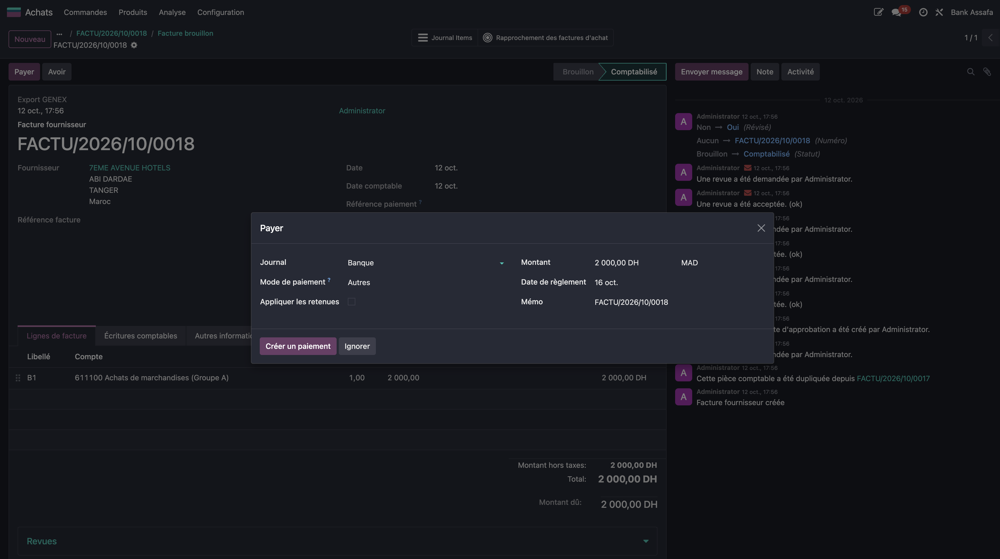

Le paiement entre dans son circuit. Une seule signature :

| Ordre | Signature | Qui |
| --- | --- | --- |
| 1 | Paiement — Validation Responsable de règlement | Groupe Responsable de règlement |

Le responsable de règlement ouvre le paiement et clique sur **Valider** dans le bandeau. Quand la revue est **Approuvé**, le paiement peut être confirmé : il passe **En cours de traitement**. L’écriture comptable reste en brouillon tant que le paiement n’est pas exporté vers GENEX, puis validé définitivement (voir la section Export GENEX).

Exemple **PBNK1/2026/00014**, virement de 3 840,00 DH, revue approuvée par le responsable de règlement. Le smart button **Facture** ramène à la facture réglée. **Écriture comptable** ouvre les comptes, y compris la RAS si elle a été appliquée.

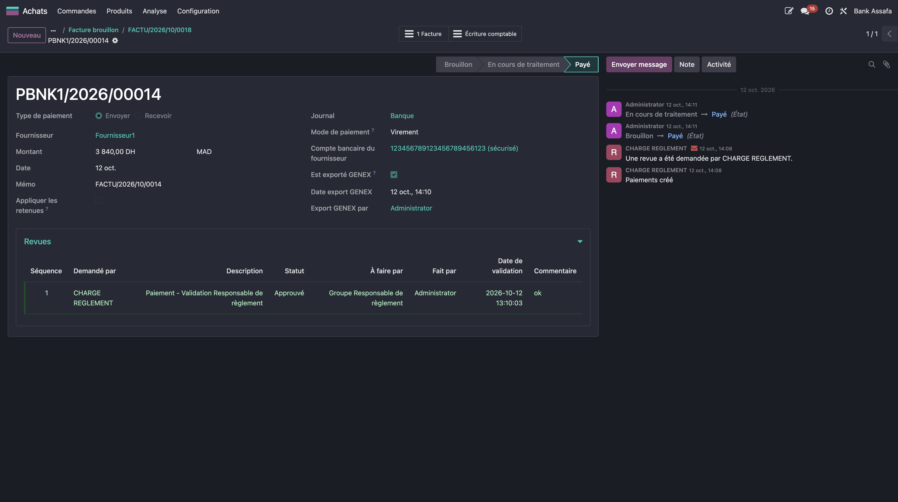

---

## 8. Contraintes

Ces blocages sont voulus. Le bouton peut disparaître, ou un message empêche l’action.

### Facture fournisseur

| Action | Bloquée quand |
| --- | --- |
| **Remettre en brouillon** | Un paiement est lié à la facture (brouillon, en cours ou payé). Il faut d’abord traiter ce paiement. |
| **Annuler** | Même règle : un paiement lié interdit l’annulation. |
| **Avoir** (extourne) | Même règle : un paiement lié interdit l’avoir. |
| **Remettre en brouillon** et **Avoir** | Réservés à la direction financière (comptabilité ou administration). Les autres profils voient le message correspondant. |
| **Comptabiliser** | Le circuit de signatures n’est pas terminé. |
| Changer le **fournisseur** | La facture est issue d’un bon de commande, même en brouillon. |
| **Remettre en brouillon** | L’écriture a déjà été exportée vers GENEX. Le bouton disparaît. |

### Paiement

| Action | Bloquée quand |
| --- | --- |
| **Confirmer** | Le circuit du responsable de règlement n’est pas approuvé. |
| **Valider** (comptabilisation définitive) | Le paiement n’a pas encore été exporté vers GENEX. Le message demande d’exporter d’abord. |
| **Remettre en brouillon** | Le paiement est déjà exporté GENEX, ou il est **Annulé**. Un paiement annulé ne se réouvre pas : il faut en créer un nouveau. |
| **Recommencer la validation** | Le paiement est déjà exporté GENEX. |
| **Remettre en brouillon** et **Annuler** | La RAS de ce paiement est déjà déclarée (déclaration de RAS TVA ou de RAS sur le revenu confirmée ou terminée). Il faut d’abord remettre cette déclaration en brouillon. |

### Demande d’achat et bon de commande

- Sans supérieur hiérarchique lié à un utilisateur sur la fiche employé, **Demander validation** est refusé.
- **Créer une demande de prix** n’apparaît que sur une demande **Approuvée** ou en cours, et seulement pour l’acheteur.
- **Confirmer la commande** n’est possible qu’après la fin du circuit du bon de commande.
- L’envoi de la demande de prix par e-mail et l’envoi du bon de commande sont réservés aux groupes prévus. Le co-ordonnateur seul ne les voit pas.
- **Créer une facture** depuis le bon de commande est réservé à la comptabilité fournisseurs ou au responsable achats.

---

## 9. Export GENEX des paiements

GENEX (iMal) reçoit les règlements fournisseurs **avant** leur comptabilisation définitive.

1. Le paiement doit être **approuvé** par le responsable de règlement et à l’état **En cours de traitement**, avec une écriture comptable associée. La case **Est exporté GENEX** est encore décochée.
2. Ouvrez **Comptabilité → Fournisseurs → Paiements**.
3. Cochez un ou plusieurs paiements, puis **Action → Export GENEX**.
4. L’assistant liste les paiements (date, référence, fournisseur, montant, journal). Retirez une ligne si elle ne doit pas partir.
5. Cliquez sur **Exporter**. Le fichier **ODOO_IMAL_REGLEMENTS_…xlsx** se télécharge. **Fermer** quitte l’assistant.

Le paiement est alors marqué **Est exporté GENEX**, avec la date et l’utilisateur. Le bouton **Valider** apparaît : il comptabilise l’écriture et passe le paiement à **Payé**.

Un paiement déjà exporté ne peut plus être remis en brouillon ni voir son circuit recommencé.

---

## 10. Export GENEX des écritures comptables

Les écritures (factures comptabilisées, provisions, extournes, paiements comptabilisés) partent dans un second fichier.

1. Menu **Comptabilité → Rapports → Export GENEX**. On peut aussi, depuis la liste ou la fiche des pièces comptables, utiliser **Action → Export GENEX**.
2. Indiquez la **date de début** et la **date de fin**. La date de début doit être avant la date de fin.
3. Les **journaux** sont facultatifs. Sans journal, toutes les écritures **comptabilisées** et **non encore exportées** de la période sont proposées.
4. Cliquez sur **Actualiser la liste** pour recharger les pièces. Retirez celles à exclure.
5. Cliquez sur **Exporter**. Le fichier **ODOO_GENEX_…xlsx** se télécharge.

Seules les écritures comptabilisées et pas encore marquées GENEX sont acceptées. Après l’export, la pièce affiche **Export GENEX** (date et utilisateur). Elle ne peut plus être remise en brouillon.

Les filtres **Non exportées GENEX** et **Exportées GENEX** sont disponibles sur la recherche des pièces.

---

## 11. Recommencer une validation

Si un montant, un fournisseur ou une ligne doit être corrigé alors que le circuit est déjà lancé :

1. Cliquez sur **Recommencer la validation**.
2. Confirmez : le circuit en cours est réinitialisé.
3. Les signatures déjà données restent visibles, avec le statut annulé.
4. Cliquez à nouveau sur **Demander validation** et refaites toutes les signatures.

Le co-ordonnateur qui n’a aucun autre rôle achats ne voit pas ce bouton. Il signe, il ne relance pas le circuit.

---

## 12. Rappels

- **Demander validation** lance les signatures. **Valider** / **Rejeter** dans le bandeau jaune les donne, une par une, dans l’ordre du bloc **Revues**.
- **Confirm** sur la demande d’achat, **Confirmer la commande** sur le bon, et **Comptabiliser** sur la facture n’interviennent qu’après la dernière signature.
- Une facture qui a un paiement ne se remet pas en brouillon, ne s’annule pas et ne s’extourne pas.
- Le paiement se comptabilise définitivement seulement après l’export GENEX.
- La réception se valide par **Valider** sur le transfert **Prêt**, ouvert depuis le smart button **Réception** du bon de commande.
- La RAS proposée sur la facture brouillon n’écrit pas dans les comptes de RAS. Ces comptes bougent au paiement.
- Sans supérieur hiérarchique lié à un utilisateur sur la fiche employé, la demande d’achat ne peut pas être soumise.
